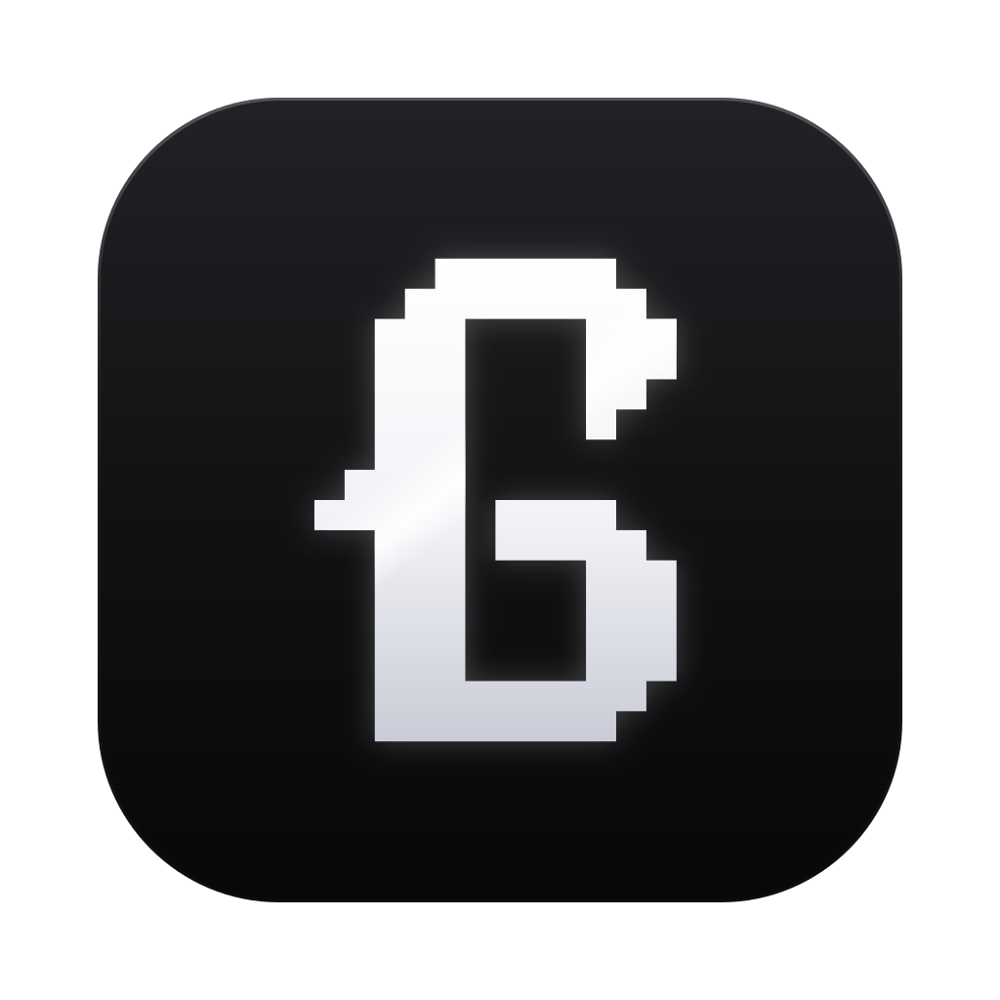

<p align="center">
  
</p>

<p align="center">
  
</p>

<p align="center">
  <strong>Cause the other agents piss me off.</strong>
</p>

<p align="center">
  <a href="https://github.com/KenKaiii/gg-framework/releases/latest"></a>
  <a href="https://github.com/KenKaiii/gg-framework/stargazers"></a>
  <a href="https://www.npmjs.com/package/@kenkaiiii/ggcoder"></a>
  <a href="LICENSE"></a>
  <a href="https://youtube.com/@kenkaidoesai"></a>
  <a href="https://skool.com/kenkai"></a>
</p>

GG Coder is a desktop coding agent that gets more out of the AI subscription you already pay for.

## Why GG Coder

- **More work per plan.** Fastest and leanest of 20 agents I raced on the same model. Claude Code used 169% more for the same work.
- **Real code, not guesses.** Agent Steroids searches real, current open-source code on your machine. No rate-limited MCP server, no limits.
- **Done means checked.** Ken Autopilot keeps the work going until it's actually verified.
- **Ship it properly, even as a beginner.** Coding is only part of it. One-click checks for security, compliance, data safety, accessibility, tests and more, plus a Project health score, so you don't need to know what to ask for.
- **Your subscriptions.** Claude, ChatGPT, Gemini, Grok, Kimi, API keys or local models.

| Agent              | Time for the full suite | Usage per suite | Time vs GG Coder | Usage vs GG Coder |
| ------------------ | ----------------------- | --------------- | ---------------- | ----------------- |
| **GG Coder**       | **102 s**               | **$0.014**      |                  |                   |
| Codewhale          | 112 s                   | $0.022          | 10% slower       | 58% more          |
| Goose              | 132 s                   | $0.020          | 29% slower       | 46% more          |
| GitHub Copilot CLI | 136 s                   | $0.025          | 33% slower       | 83% more          |
| Kimi Code          | 138 s                   | $0.024          | 36% slower       | 74% more          |
| Claude Code        | 142 s                   | $0.037          | 39% slower       | 169% more         |
| ForgeCode          | 155 s                   | $0.042          | 52% slower       | 204% more         |
| Dirac              | 160 s                   | $0.029          | 57% slower       | 114% more         |
| Crush              | 165 s                   | $0.037          | 62% slower       | 173% more         |
| Factory Droid      | 167 s                   | $0.025          | 64% slower       | 83% more          |
| Mistral Vibe       | 169 s                   | $0.036          | 66% slower       | 164% more         |
| DeepSeek-Reasonix  | 170 s                   | $0.027          | 67% slower       | 99% more          |
| Oh My Pi           | 170 s                   | $0.031          | 67% slower       | 123% more         |
| Xum                | 172 s                   | $0.041          | 69% slower       | 203% more         |
| Docker Agent       | 173 s                   | $0.021          | 70% slower       | 51% more          |
| Qwen Code          | 177 s                   | $0.049          | 74% slower       | 257% more         |
| Prime Agent        | 190 s                   | $0.029          | 86% slower       | 111% more         |
| Hermes Agent       | 190 s                   | $0.027          | 87% slower       | 100% more         |
| Deep Agents        | 201 s                   | $0.041          | 97% slower       | 198% more         |
| jcode              | 380 s                   | $0.178          | 274% slower      | 1196% more        |

<sub>Table: one full race on 4 November 2026. 20 agents, each on a current stable release (GG Coder v0.102.0), 7 tasks, 5 runs each (700 runs), all on Claude Haiku 5.5 with the same thinking setting. Every agent got the same prompts and a fresh copy of the project each run, and ran bare, GG Coder included: its own built-in prompt and tools, with no skills, plugins, MCP servers or custom instructions. The tasks use small test projects plus one question about Vite's codebase (v8.3.5), so no agent works on its own code. A run counts only if hidden tests pass or the answer is correct.</sub>

## Also included

- **GG Goals:** hand over a whole goal; a team of workers sees it through.
- **Chat:** conversations that remember context.
- **GG Motion:** turns your ideas into videos.

## Get started

1. Install GG Coder:

   **macOS (Apple Silicon):** [Download the latest release](https://github.com/KenKaiii/gg-framework/releases/latest) and open the `.dmg`.

   **Windows:** [Download the latest release](https://github.com/KenKaiii/gg-framework/releases/latest) and run the `.exe` installer.

   **Linux (x86_64):** [Download the latest release](https://github.com/KenKaiii/gg-framework/releases/latest) and install the `.deb` (`sudo apt install ./GG*.deb`) or `.rpm` (`sudo dnf install ./GG*.rpm`).

   **Development:** With Node.js 22 or newer, pnpm 10 (the repo pins `pnpm@10.17.1`; `corepack enable` picks it up), and the [Tauri prerequisites](https://v2.tauri.app/start/prerequisites/) installed:

   ```bash
   git clone https://github.com/KenKaiii/gg-framework.git
   cd gg-framework
   pnpm install
   pnpm build
   pnpm --filter gg-app tauri dev
   ```

2. Open the app, connect your AI provider, and pick Code, Chat, or Motion.

3. Check your changes (from the repo root):

   ```bash
   pnpm check          # typecheck every package
   pnpm lint           # ESLint
   pnpm format:check   # Prettier, read-only
   pnpm test           # full test suite
   ```

   For app-only work, `pnpm --filter gg-app check`, `lint` and `test` are quicker. See [gg-app/README.md](gg-app/README.md).

### Optional settings

Nothing needs an `.env` file: you sign in to providers inside the app. These environment variables are optional overrides:

| Variable                                                                   | What it does                                                                           |
| -------------------------------------------------------------------------- | -------------------------------------------------------------------------------------- |
| `GG_AGENT_DIR`                                                             | Absolute path for settings, sessions and logins. Defaults to `~/.gg`.                  |
| `AZURE_OPENAI_API_KEY`, `AZURE_OPENAI_BASE_URL`, `AZURE_OPENAI_DEPLOYMENT` | Azure OpenAI connection. The base URL must be a full `https` Responses endpoint.       |
| `AZURE_OPENAI_MODEL_ID`                                                    | Optional model name to show for the Azure deployment.                                  |
| `GGCODER_GEMINI_OAUTH_CLIENT_ID`, `GGCODER_GEMINI_OAUTH_CLIENT_SECRET`     | Use your own Google Cloud OAuth client for Gemini sign-in instead of the built-in one. |

## This Local Fork

This checkout is a local fork of [KenKaiii/gg-framework](https://github.com/KenKaiii/gg-framework) that carries its own fixes. It builds as a separate app, **GG Coder Local Fork**, so it never overwrites the official install, and it doesn't use the official update feed.

- Build the fork's installer: `pnpm app:build:local-patched`
- Pull in upstream changes and keep the local fixes: `pnpm app:update:local-fixes` (checks only by default; it never pushes unless you pass `--push`)

How updates and protected branches work is in [gg-app/LOCAL_FIXES.md](gg-app/LOCAL_FIXES.md).

## Build with the framework

Want the engine without the desktop app? Use the same packages in your own apps. Install just what you need.

- [**@kenkaiiii/gg-ai**](packages/gg-ai/README.md): Connect to AI providers and stream responses.
- [**@kenkaiiii/gg-agent**](packages/gg-agent/README.md): Build agents that use your tools and work through tasks.
- [**@kenkaiiii/gg-core**](packages/gg-core/README.md): Model selection, authentication, and local model discovery.
- [**@kenkaiiii/ggcoder**](packages/ggcoder/README.md): The coding agent, sessions, and tools behind the app and CLI.

For your own agent, start here:

```bash
npm install @kenkaiiii/gg-ai @kenkaiiii/gg-agent
```

The package links above cover setup and usage. Licensed under AGPL-3.0: you can build on it, and if you distribute your changes or run them as a network service, you share their source under the same license.

## Learn with me

Come build with me in my [Skool community](https://skool.com/kenkai). Get help, share what you're making, and learn how to get more out of AI.
